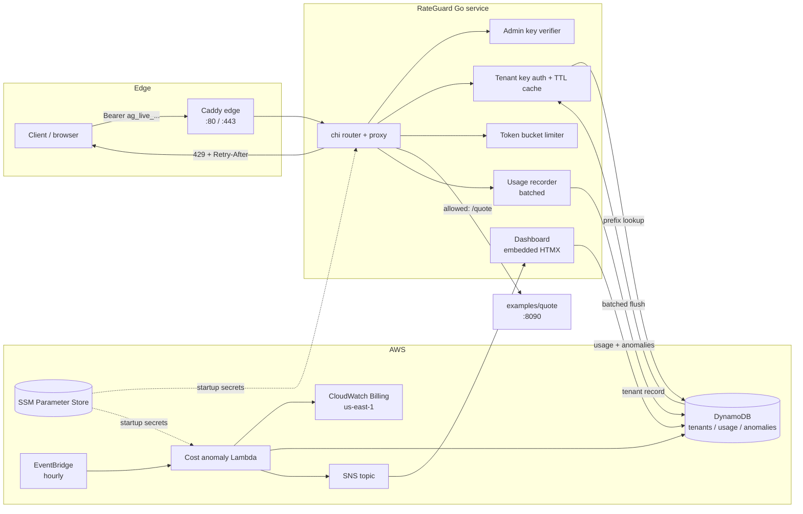
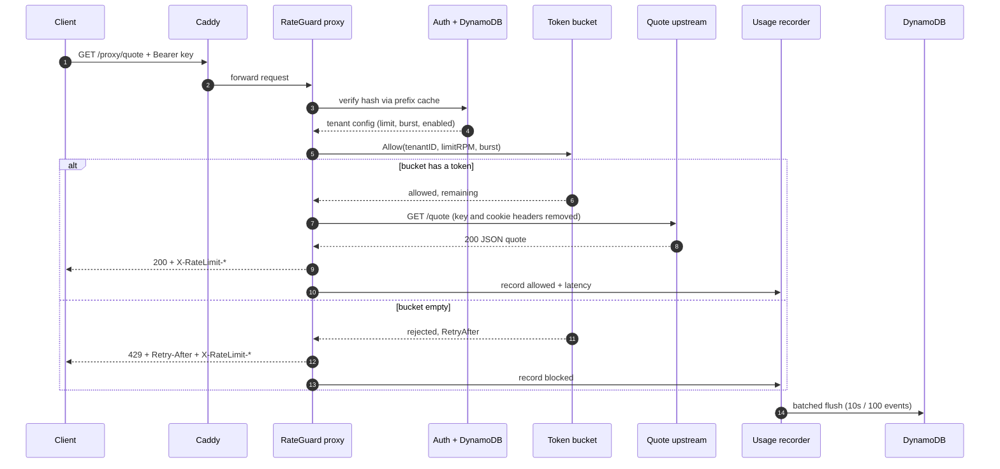
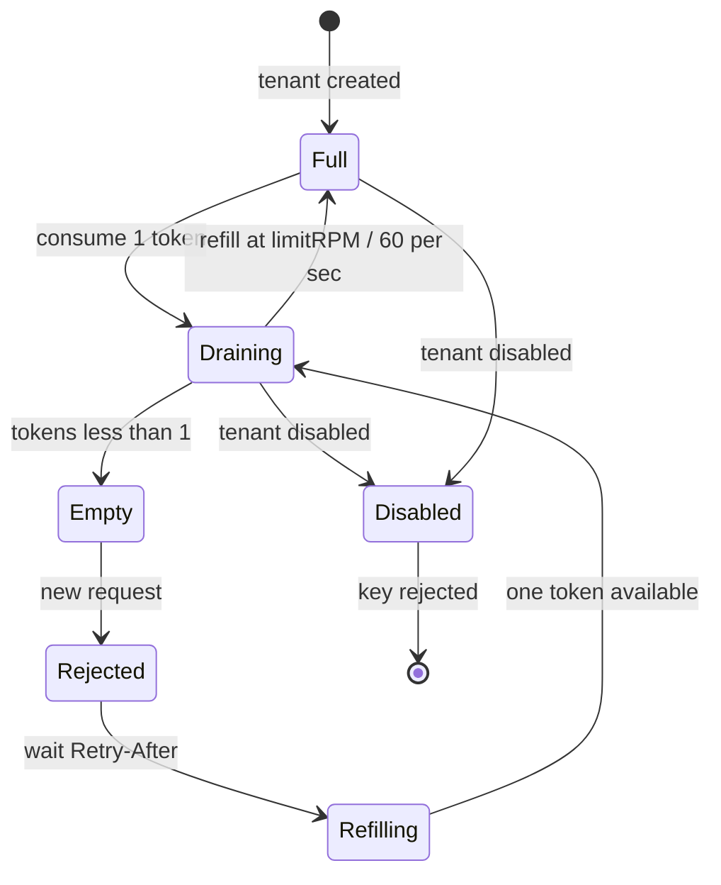
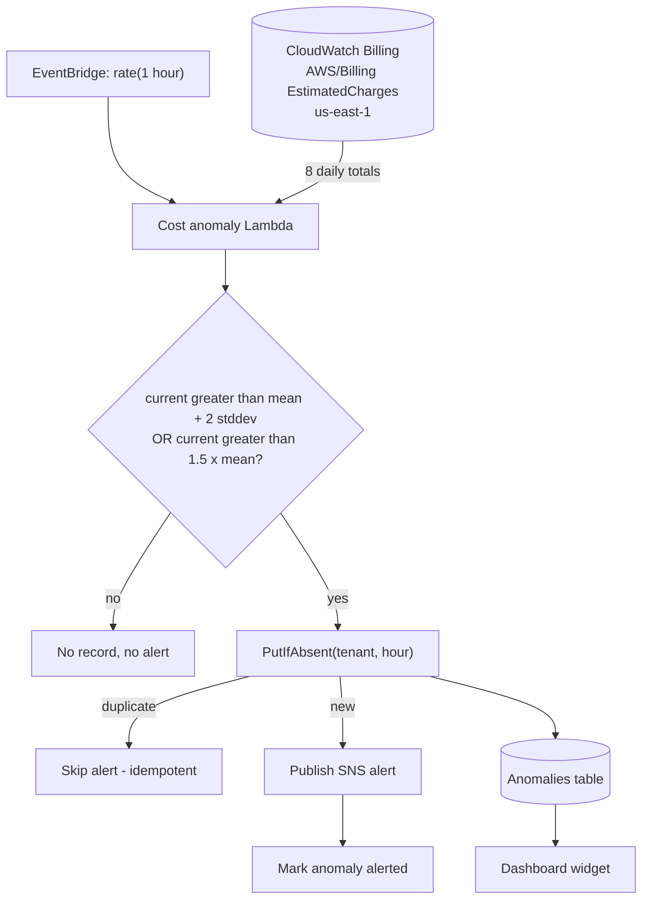
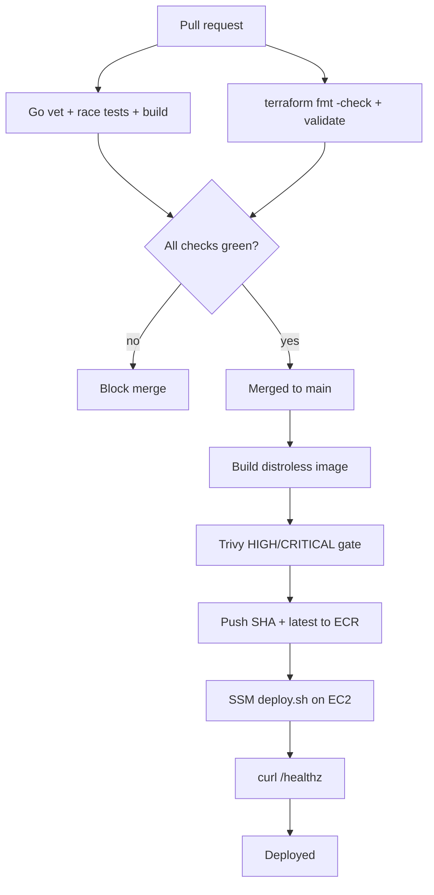

<p align="center">
  
</p>

# RateGuard

> [!WARNING]
> **This project is not production ready. Do not deploy it to production or use it to protect real traffic or sensitive data.** It is a learning/portfolio implementation with single-instance in-memory rate-limit state, no high availability, no authenticated encryption at rest beyond AWS defaults, and known simplification documented below. Use it for local demos and controlled AWS free-tier exercises only.

Multi-tenant API rate limiting (token bucket) plus AWS cost anomaly detection, with a small operator dashboard. Built with Go, chi, DynamoDB, Docker, and Terraform.

> **Status:** implementation and configuration are complete in this repository. No Docker build, Terraform apply, or AWS deployment was run by the coding agent. The Docker and Terraform sections are yours to execute; the guides contain every command.

---

## Architecture

### High-level dataflow



### Request lifecycle through the proxy



### Token bucket states



### Data model

```mermaid
erDiagram
  TENANTS ||--o{ USAGE : "hourly usage"
  TENANTS {
    string tenant_id PK
    string name
    string email
    string api_key_hash
    string api_key_prefix "GSI lookup"
    int limit_rpm
    int burst
    boolean enabled
    string created_at
    string updated_at
  }
  USAGE {
    string tenant_id PK
    string bucket SK "YYYY-MM-DDTHH"
    int allowed
    int blocked
    int count
    int sum_latency_ms
    map latency_hist
    int ttl "30 days"
  }
  ANOMALIES {
    string tenant_id PK "__account__"
    string detected_at SK "hour bucket"
    string metric
    float value
    float baseline
    float threshold
    string severity
    boolean alerted
  }
```

Anomalies use the reserved `__account__` tenant because AWS billing data is account-wide, not per tenant.

### Cost anomaly pipeline



### CI/CD pipeline



- **Tenant keys:** `ag_live_<random>`; shown once, stored as SHA-256 plus a short prefix, verified in constant time with a bounded TTL cache.
- **Limiting:** per-tenant capacity = `burst`, refill = `limit_rpm / 60` tokens/s. Exceeded requests get `429` + `Retry-After` and `X-RateLimit-*` headers.
- **Usage:** buffered and flushed in batches; average and approximate p95 come from a fixed latency histogram.
- **Cost anomalies:** account-wide `AWS/Billing EstimatedCharges` versus a seven-day baseline (`> baseline + 2σ` or `> 1.5 × baseline`), deduplicated per UTC hour.
- **Dashboard:** session-authenticated (HMAC cookie, CSRF-protected mutations), server-rendered HTML with vendored htmx. No CDN assets; the brand logo is embedded under `web/static/logo.png`.

---

## Repository layout

| Path                                                   | Purpose                                                                                        |
| ------------------------------------------------------ | ---------------------------------------------------------------------------------------------- |
| `cmd/server`                                           | RateGuard API, rate-limit proxy, and dashboard entrypoint (`-healthcheck` flag for containers) |
| `cmd/lambda`                                           | Scheduled cost anomaly detector; supports `COST_FAKE_*` for demos                              |
| `examples/quote`                                       | "Quote of the Day" example upstream used by the proxy demo                                     |
| `internal/limiter`, `internal/auth`                    | Token bucket, API/admin keys, login attempt limiting                                           |
| `internal/store`, `internal/usage`                     | In-memory + DynamoDB persistence, batched usage writer                                         |
| `internal/server`                                      | chi router, middleware, admin API, proxy, dashboard handlers                                   |
| `internal/cost`                                        | Anomaly evaluation, CloudWatch/SNS adapters, worker                                            |
| `web/`                                                 | Embedded templates, CSS, JS, htmx, and `logo.png`                                              |
| `terraform/`                                           | Root AWS stack + `bootstrap/` for remote state                                                 |
| `deploy/Caddyfile`                                     | Edge proxy configuration used by compose                                                       |
| `.github/workflows/ci.yml`                             | Test → validate → scan/push → SSM deploy                                                       |
| `docs/index.html`, `docs/styles.css`, `docs/script.js` | Static marketing landing page (open `docs/index.html`)                                         |
| `docs/AWS-DEPLOYMENT-GUIDE.md`, `docs/aws.html`        | Detailed AWS deployment runbook (Markdown + web page)                                          |
| `docs/docker/`, `docs/terraform/`                      | Operator guides you execute manually                                                           |
| `docs/UI-DESIGN.md`, `docs/SECURITY-AUDIT.md`          | Design retrofit and security audit reports                                                     |

There is intentionally **no root `main.go`**. Go builds every package with `go build ./...`, and the server is started with `go run ./cmd/server`.

---

## Run locally with Go (no Docker)

From the repository root, in **Git Bash**:

```bash
export ADMIN_API_KEY="dev-admin-key-1234567890"
export SESSION_SECRET="dev-session-secret-12345678901234567890"
export STORE_BACKEND=memory
export PROXY_UPSTREAM_URL=http://localhost:8090
go run ./cmd/server
```

From the repository root, in **PowerShell**:

```powershell
$env:ADMIN_API_KEY="dev-admin-key-1234567890"
$env:SESSION_SECRET="dev-session-secret-12345678901234567890"
$env:STORE_BACKEND="memory"
$env:PROXY_UPSTREAM_URL="http://localhost:8090"
go run ./cmd/server
```

`go run` does not read `.env` files — export the variables in your shell (Docker Compose does read `.env` via `env_file`).

> **If the browser says `localhost refused to connect`, you opened port 80.** A plain `go run` serves on **8080**: use `http://localhost:8080/healthz` and `http://localhost:8080/dashboard`. Port 80 is only exposed when you run the Docker Compose stack, where Caddy forwards to the app. If `127.0.0.1:8080/healthz` still refuses, confirm the Go process is still running and check `netstat -ano | findstr :8080`.
>
> **If sign-in shows "Request origin was not accepted"**, open `http://localhost:8080/dashboard` directly in the address bar and submit from that page. Opening the form from a different host or port (for example the static landing page on `:8000`, or a port-forwarded URL) can make the browser send a mismatched `Origin`. Recent builds also accept loopback aliases and trusted forwarded hosts.

In a **second terminal**, start the demo upstream:

```bash
go run ./examples/quote
```

Then create a tenant and exercise the proxy:

```bash
KEY=$(curl -s -X POST http://localhost:8080/api/v1/tenants \
  -H "Authorization: Bearer $ADMIN_API_KEY" \
  -H 'Content-Type: application/json' \
  -d '{"name":"Demo","email":"demo@example.com","limit_rpm":60,"burst":5}' \
  | python -c 'import json,sys; print(json.load(sys.stdin)["api_key"])')

for i in $(seq 1 20); do
  curl -s -o /dev/null -w "%{http_code}\n" \
    -H "Authorization: Bearer $KEY" \
    http://localhost:8080/proxy/quote
done
```

Expect a run of `200`s up to the burst, then `429`s with `Retry-After`.

Dashboard: `http://localhost:8080/dashboard` — sign in with the admin key. The one-time API key appears only when the tenant is created.

With `STORE_BACKEND=memory`, tenants and token buckets reset on restart. That is intentional for local development; AWS uses DynamoDB.

---

## Run locally with Docker

```bash
cp .env.example .env
# generate ADMIN_API_KEY and SESSION_SECRET (see the guide)
docker compose up -d --build
```

Dashboard: `http://localhost/dashboard`. Full commands, PowerShell alternatives, TLS, the EC2 variant, and teardown are in **[docs/docker/DOCKER-GUIDE.md](docs/docker/DOCKER-GUIDE.md)**.

---

## Deploy to AWS

1. Build the Lambda binary: `GOOS=linux GOARCH=arm64 CGO_ENABLED=0 go build -o build/bootstrap ./cmd/lambda`.
2. Bootstrap remote state and apply the root stack via the Terraform Docker image.
3. Push the first image to ECR; CI handles later pushes.
4. Set repository variables `AWS_ROLE_ARN`, `ECR_REPOSITORY_URL`, `EC2_INSTANCE_ID`, `PUBLIC_HEALTH_URL`, then push to `main`.

A copy-paste operator runbook — credentials, OIDC, state bootstrap, apply, first ECR push, verification, fake-spend test, CI variables, rollback, and teardown — is in **[docs/AWS-DEPLOYMENT-GUIDE.md](docs/AWS-DEPLOYMENT-GUIDE.md)**. The styled web version is **[docs/aws.html](docs/aws.html)**. File-by-file Terraform explanations are in **[docs/terraform/TERRAFORM-EXPLAINED.md](docs/terraform/TERRAFORM-EXPLAINED.md)**.

---

## API summary

Base: `/api/v1`. Admin routes use `Authorization: Bearer <admin key>` (or `X-Admin-Key`).

| Method | Path                  | Auth            | Notes                                                                               |
| ------ | --------------------- | --------------- | ----------------------------------------------------------------------------------- |
| POST   | `/tenants`            | admin           | `{"name","email","limit_rpm","burst"}` → `{"tenant_id","api_key"}` (key shown once) |
| GET    | `/tenants`            | admin           | List tenants                                                                        |
| GET    | `/tenants/{id}`       | admin           | Tenant object; hash is never returned                                               |
| PATCH  | `/tenants/{id}`       | admin           | `limit_rpm`, `burst`, `enabled`                                                     |
| DELETE | `/tenants/{id}`       | admin           | Soft delete (`enabled=false`)                                                       |
| GET    | `/tenants/{id}/usage` | admin or tenant | `?from=&to=`; summary with avg/p95                                                  |
| ANY    | `/proxy/*`            | tenant          | Forwards to upstream; `429` + headers on exceed                                     |
| GET    | `/healthz`, `/readyz` | none            | Liveness / store readiness                                                          |

Errors use `{"error":"<code>","message":"<human>"}` with codes `unauthorized`, `forbidden`, `not_found`, `rate_limited`, `invalid_input`, `internal`.

---

## Verification

```
go build ./...
go vet ./...
go test -race ./...
```

All pass, including end-to-end proxy/429 and dashboard login/CSRF tests. `staticcheck` in this environment is too old for Go 1.27 standard-library export data and was not usable.

---

## Known v1 boundaries

- Token buckets are per process and reset on restart; usage has a bounded flush queue and can lose the final batch on a hard kill.
- p95 is approximated from fixed histogram buckets.
- AWS billing is account-wide, so anomalies use the reserved `__account__` scope.
- DynamoDB writes are sequential within a flush; sized for the free tier, not high throughput.
- Single EC2 instance means no multi-AZ failover — an explicit trade-off from the PRD.

## Teardown

- Local Go: stop the processes with `Ctrl+C`.
- Local Docker: `docker compose down -v` (see Docker guide).
- AWS: `terraform destroy`, then destroy the separate bootstrap stack (see Terraform guide).
