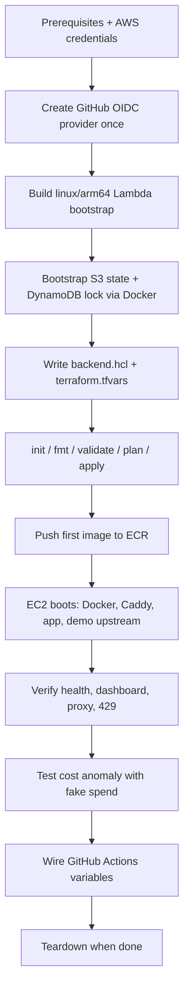

# RateGuard AWS deployment runbook

> **You run every command in this guide.** No Docker build, Terraform apply, or AWS change was performed by the coding agent. RateGuard is a learning project and **not production ready** — use a disposable AWS account or a free-tier-safe sandbox, and tear it down when finished.

This is the single execution checklist for deploying RateGuard to AWS with Terraform **run through Docker** (no local Terraform install). Region defaults to `ap-south-1` (Mumbai). For line-by-line explanations of the Terraform files, read [`terraform/TERRAFORM-EXPLAINED.md`](terraform/TERRAFORM-EXPLAINED.md); for the web version, open [`aws.html`](aws.html).



---

## 0. What you will have at the end

| Area | Resource |
|---|---|
| Network | VPC `10.20.0.0/16`, one public subnet, IGW, route table, security group (80/443 only) |
| Compute | One `t3.micro` EC2 running Amazon Linux 2023, IMDSv2, encrypted 10 GB gp3 root |
| Containers | `api` (Go proxy + dashboard), `demo` (quote upstream), `caddy` (edge) |
| Data | DynamoDB `api_guard_tenants` (+ `api_key_prefix-index`), `api_guard_usage` (30-day TTL), `api_guard_cost_anomalies` |
| Registry | ECR repo with scan-on-push and keep-10 lifecycle policy |
| Config | SSM `SecureString` `/rateguard/admin-api-key`, `/rateguard/session-secret`; `String` `/rateguard/sns-topic-arn`, `/rateguard/upstream-url` |
| Alerts | SNS cost-anomaly topic, separate us-east-1 billing topic with a $1 alarm |
| Worker | arm64 Lambda + EventBridge hourly rule + CloudWatch log group |
| CI | GitHub OIDC role restricted to `main`, ECR push + SSM deploy |
| State | Private encrypted versioned S3 bucket + DynamoDB lock table |

---

## 1. Prerequisites

1. **AWS account** with permission to create: VPC, subnet, IGW, route table, security group, EC2, IAM roles/policies/OIDC provider, DynamoDB, S3, ECR, SSM, SNS, CloudWatch, Lambda, EventBridge.
2. **AWS CLI v2** installed and logged in. Check:
   ```bash
   aws sts get-caller-identity
   ```
   If you use SSO: `aws sso login --profile <your-profile>` and remember the profile name.
3. **Docker Desktop** running with Linux containers.
4. **Go 1.27+** locally to build the Lambda binary.
5. A **GitHub repository** you control (the OIDC role trusts `Aswanidev-vs/RateGuard` by default; change `local.github_repo` in `terraform/main.tf` if yours differs).

### Shell conventions

Terraform runs in a container with the repo mounted. The AWS credentials must also be visible to the container.

**Git Bash / macOS / Linux:**

```bash
docker run --rm \
  -v "$HOME/.aws:/root/.aws:ro" \
  -v "/$PWD:/workspace" \
  -w /workspace \
  -e AWS_PROFILE \
  hashicorp/terraform:1.9.8 <terraform command>
```

**PowerShell:**

```powershell
docker run --rm `
  -v "${HOME}\.aws:/root/.aws:ro" `
  -v "${PWD}:/workspace" `
  -w /workspace `
  -e AWS_PROFILE `
  hashicorp/terraform:1.9.8 <terraform command>
```

If you use static keys instead of a profile, replace the mount with `-e AWS_ACCESS_KEY_ID -e AWS_SECRET_ACCESS_KEY -e AWS_SESSION_TOKEN`. Never put keys in a file in the repo.

This guide uses `TF=` as shorthand for the matching line above.

---

## 2. Create the GitHub OIDC provider once

GitHub Actions assumes an AWS role without storing a static access key. The provider is account-wide and only needs creating once.

Check whether it already exists:

```bash
aws iam list-open-id-connect-providers \
  --query 'OpenIDConnectProviderList[?Arn==`arn:aws:iam::'"$(aws sts get-caller-identity --query Account --output text)"':oidc-provider/token.actions.githubusercontent.com`]' \
  --output text
```

If it is empty, create it:

```bash
THUMBPRINT=$(openssl s_client -servername token.actions.githubusercontent.com \
  -connect token.actions.githubusercontent.com:443 -showcerts </dev/null 2>/dev/null \
  | openssl x509 -fingerprint -sha1 -noout \
  | cut -d= -f2 | tr -d ':' | tr 'A-Z' 'a-z')

aws iam create-open-id-connect-provider \
  --url https://token.actions.githubusercontent.com \
  --client-id-list sts.amazonaws.com \
  --thumbprint-list "$THUMBPRINT"
```

If the CLI approach fails, create the same provider in the AWS Console → IAM → Identity providers → Add provider. Terraform only references the provider by ARN; it does not create it.

---

## 3. Build the Lambda binary before Terraform

The `archive_file` data source needs a real file at plan time. From the repository root:

**Git Bash:**

```bash
mkdir -p build
GOOS=linux GOARCH=arm64 CGO_ENABLED=0 \
  go build -trimpath -o build/bootstrap ./cmd/lambda
```

**PowerShell:**

```powershell
New-Item -ItemType Directory -Force build | Out-Null
$env:GOOS="linux"; $env:GOARCH="arm64"; $env:CGO_ENABLED="0"
go build -trimpath -o build/bootstrap ./cmd/lambda
```

The file must be exactly `build/bootstrap` — no extension. Terraform zips it into `terraform/rateguard-cost-lambda.zip`.

---

## 4. Bootstrap remote state (one time)

From `G:\RateGuard\terraform\bootstrap`:

```bash
# TF = the docker run line from section 1
TF init
TF apply -var='bucket_name=rateguard-tfstate' -var='region=ap-south-1'
```

Terraform appends a random suffix to the bucket name. Copy the outputs:

```bash
TF output -raw state_bucket
TF output -raw lock_table
```

Create `terraform/backend.hcl` (gitignored) with those values:

```hcl
bucket         = "PASTE_STATE_BUCKET_OUTPUT"
key            = "rateguard/dev/terraform.tfstate"
region         = "ap-south-1"
encrypt        = true
dynamodb_table = "PASTE_LOCK_TABLE_OUTPUT"
```

The bootstrap stack keeps its own local `terraform.tfstate` in `terraform/bootstrap/`. It contains no secrets, but back it up.

---

## 5. Configure the root stack

From `G:\RateGuard\terraform`:

```bash
cp terraform.tfvars.example terraform.tfvars
```

Edit `terraform.tfvars`:

```hcl
admin_email       = "you@example.com"   # confirm both SNS subscriptions
domain_name       = ""                  # HTTP on public IP; set a DNS name for HTTPS
allowed_ssh_cidr  = ""                  # keep SSH disabled; use SSM Session Manager
app_image_tag     = "latest"
alarm_threshold_usd = 1
```

Generate secrets and supply them as environment variables so they never touch disk:

**Git Bash:**

```bash
export TF_VAR_admin_api_key="$(openssl rand -base64 48)"
export TF_VAR_session_secret="$(openssl rand -base64 48)"
```

**PowerShell:**

```powershell
$env:TF_VAR_admin_api_key = [Convert]::ToBase64String((1..48 | ForEach-Object { Get-Random -Maximum 256 }))
$env:TF_VAR_session_secret = [Convert]::ToBase64String((1..48 | ForEach-Object { Get-Random -Maximum 256 }))
```

Remove or replace the placeholder values in `terraform.tfvars`; environment variables win.

> **Save the admin key somewhere safe now.** You will need it to sign in. It is also readable later from SSM (section 8).

---

## 6. Plan and apply

From `G:\RateGuard\terraform`:

```bash
TF init -backend-config=backend.hcl
TF fmt -check
TF validate
TF plan -out=tfplan
TF apply tfplan
```

If `fmt -check` fails, run `TF fmt` (writes formatting) and commit the result. `validate` does not need AWS credentials or the Lambda file; `plan` does.

Recommended first run: use two stages so the repository exists before the EC2 boot script tries to pull an image.

```bash
TF apply -target=aws_ecr_repository.app
# push the first image (section 7)
TF apply
```

A single `apply` also works: user data retries the ECR pull for up to 10 minutes.

---

## 7. Push the first image to ECR

From the repository root, on the host (not in the Terraform container):

```bash
ECR=$(docker run --rm \
  -v "/$PWD/terraform:/workspace" -w /workspace \
  -v "$HOME/.aws:/root/.aws:ro" -e AWS_PROFILE \
  hashicorp/terraform:1.9.8 output -raw ecr_repository_url)

aws ecr get-login-password --region ap-south-1 \
  | docker login --username AWS --password-stdin "$ECR"

docker build --build-arg VERSION=bootstrap --build-arg COMMIT=bootstrap \
  -t rateguard:bootstrap .

docker tag rateguard:bootstrap "$ECR:latest"
docker push "$ECR:latest"
```

The EC2 user data installs Docker, writes `/opt/rateguard/{.env,docker-compose.yml,Caddyfile,deploy.sh}`, logs into ECR, pulls `api` and `demo`, and starts the stack.

---

## 8. Verify the deployment

From `G:\RateGuard\terraform`, capture outputs:

```bash
TF output
TF output -raw ec2_public_ip
TF output -raw dashboard_url
TF output -raw ecr_repository_url
TF output -raw github_actions_role_arn
TF output -raw sns_topic_arn
```

On your host:

```bash
IP=$(cd terraform && docker run --rm -v "/$PWD:/workspace" -w /workspace \
  -v "$HOME/.aws:/root/.aws:ro" -e AWS_PROFILE \
  hashicorp/terraform:1.9.8 output -raw ec2_public_ip)

curl -s http://$IP/healthz     # {"status":"ok"}
curl -s http://$IP/readyz      # {"status":"ready"} - checks DynamoDB
```

Get the admin key and sign in:

```bash
aws ssm get-parameter --name /rateguard/admin-api-key \
  --with-decryption --query Parameter.Value --output text
```

Open the `dashboard_url` output, sign in with that key, create a tenant, copy the one-time `ag_live_...` key, then:

```bash
KEY=ag_live_your_key_here
for i in $(seq 1 120); do
  curl -s -o /dev/null -w "%{http_code}\n" \
    -H "Authorization: Bearer $KEY" \
    "http://$IP/proxy/quote"
done
# first `burst` pass with 200, then 429 with Retry-After
```

If the stack did not start, read the boot log through SSM:

```bash
aws ssm send-command --instance-ids <instance-id> \
  --document-name AWS-RunShellScript \
  --parameters 'commands=["sudo tail -n 100 /var/log/rateguard-userdata.log"]'
```

---

## 9. Test the cost anomaly worker

Get the Lambda name and topic ARN from outputs. The default name is `rateguard-dev-cost-anomaly`.

```bash
aws lambda update-function-configuration \
  --function-name rateguard-dev-cost-anomaly \
  --environment 'Variables={
    AWS_REGION=ap-south-1,
    COST_BILLING_REGION=us-east-1,
    COST_FAKE_CURRENT=9.5,
    COST_FAKE_HISTORY=1.1,1.2,1.0,1.3,1.1,1.2,1.0,
    DYNAMODB_TENANTS_TABLE=api_guard_tenants,
    DYNAMODB_USAGE_TABLE=api_guard_usage,
    DYNAMODB_ANOMALIES_TABLE=api_guard_cost_anomalies,
    SNS_TOPIC_ARN=<sns_topic_arn>,
    COST_METRIC_NAME=EstimatedCharges
  }'

aws lambda invoke --function-name rateguard-dev-cost-anomaly /tmp/rateguard-lambda.json
cat /tmp/rateguard-lambda.json
```

Then confirm:

- `/dashboard/anomalies` shows a finding for `__account__`
- `api_guard_cost_anomalies` has a record
- the confirmed SNS email arrives
- invoking again in the same UTC hour produces **no second alert**

Restore the real environment by re-running `TF apply` from `terraform/`.

---

## 10. Wire GitHub Actions

Set these **repository variables** (Settings → Secrets and variables → Actions → Variables):

| Variable | Value from |
|---|---|
| `AWS_ROLE_ARN` | `github_actions_role_arn` output |
| `ECR_REPOSITORY_URL` | `ecr_repository_url` output |
| `EC2_INSTANCE_ID` | EC2 instance ID from the console or `aws ec2 describe-instances` |
| `PUBLIC_HEALTH_URL` | `http://<public-ip>` or `https://<domain>` |

What happens on `push` to `main`:

1. Go vet, race tests, build.
2. Terraform format + validate.
3. Build distroless image → Trivy HIGH/CRITICAL scan → push SHA + `latest` to ECR.
4. `aws ssm send-command` runs `sudo /opt/rateguard/deploy.sh <sha>` on EC2.
5. Smoke test `GET /healthz`.

Pull requests only run tests and Terraform checks.

Rollback by redeploying a previous SHA:

```bash
aws ssm send-command --instance-ids <instance-id> \
  --document-name AWS-RunShellScript \
  --parameters 'commands=["sudo /opt/rateguard/deploy.sh <previous-sha>"]'
```

---

## 11. Day-two operations

| Task | Command / action |
|---|---|
| Stop billing while idle | Stop the EC2 instance from the console or `aws ec2 stop-instances --instance-ids <id>` |
| Start again | `aws ec2 start-instances --instance-ids <id>`, then re-check `/healthz` |
| Rotate admin key | Change `TF_VAR_admin_api_key` and `TF_VAR_session_secret`, then `TF apply`; dashboard sessions are signed out |
| View app logs | `ssh` is disabled; use `aws ssm start-session --target <instance-id>` then `docker logs -f $(docker ps -f name=api -q)` |
| View Lambda logs | CloudWatch log group `/aws/lambda/rateguard-dev-cost-anomaly` |
| Deploy manually | `sudo /opt/rateguard/deploy.sh <image-tag>` on the instance via SSM |

---

## 12. Teardown

1. Confirm the email subscriptions if you want them removed by deleting the topic.
2. From `G:\RateGuard\terraform`: `TF destroy`.
3. From `G:\RateGuard\terraform\bootstrap`: `TF destroy` (state bucket and lock table survive the root destroy intentionally).
4. Stop or terminate the EC2 instance if anything remains.

ECR and S3 are configured with force-delete flags, so images and artifacts do not block destroy.

---

## 13. Troubleshooting

| Symptom | Cause / fix |
|---|---|
| Terraform container says no credentials | Mount `~/.aws` and pass `AWS_PROFILE`, or pass `AWS_*` env vars |
| `Error: No credential providers` | Same as above; run `aws sts get-caller-identity` on the host first |
| `archive_file: no such file` | Build `build/bootstrap` before plan/apply |
| `terraform fmt -check` fails | Run `TF fmt` and commit the formatting |
| EC2 has no stack | Check `/var/log/rateguard-userdata.log`; usually ECR login or image pull |
| `/readyz` returns 503 | Instance role cannot read DynamoDB; check IAM policy and `SSM_PARAM_PREFIX` |
| Dashboard login fails | Read `/rateguard/admin-api-key` from SSM; confirm `SSM_ENABLED=true` |
| Cookies do not stick | `COOKIE_SECURE=true` only with HTTPS; set `domain_name` and DNS |
| Billing alarm never fires | Billing metrics exist only in us-east-1 and can lag ~24h |
| Lambda records anomaly but no alert | Check SNS publish permission and confirmed subscription |
| SSH refused | Intended; `allowed_ssh_cidr` is empty by default — use SSM Session Manager |

---

## 14. Security and cost notes

- No long-lived AWS keys are stored in GitHub Actions; OIDC is scoped to `main`.
- Terraform state contains the admin key and session secret. The bucket is private, encrypted, and versioned — restrict access to it.
- SSH is disabled unless you explicitly set `allowed_ssh_cidr`.
- IMDSv2 is required on EC2; the instance role has only the permissions the app needs.
- The app reads secrets from SSM at startup; none are baked into the image or user data.
- `t3.micro` is free-tier eligible for 750 hours/month. Stop it between demos.
- The $1 billing alarm is a safety net, not a budget. Delete resources when finished.

---

## 15. One-screen command reference

```bash
# 1. Build Lambda
GOOS=linux GOARCH=arm64 CGO_ENABLED=0 go build -trimpath -o build/bootstrap ./cmd/lambda

# 2. Bootstrap state (from terraform/bootstrap)
TF init && TF apply -var='bucket_name=rateguard-tfstate' -var='region=ap-south-1'

# 3. Root stack (from terraform/, after backend.hcl + tfvars)
TF init -backend-config=backend.hcl
TF fmt -check && TF validate
TF plan -out=tfplan && TF apply tfplan

# 4. Verify
TF output
curl -s http://$(TF output -raw ec2_public_ip)/healthz

# 5. Teardown
TF destroy   # then destroy terraform/bootstrap separately
```
